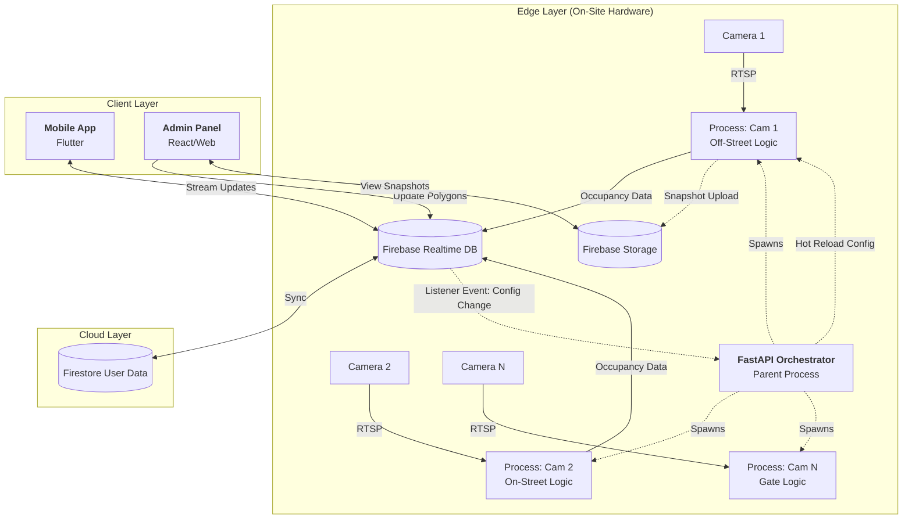

# Smart Parking System Architecture

## 1. System Overview

This project is an IoT-based Smart Parking solution that utilizes Computer Vision to detect real-time parking occupancy. The system follows an **Edge-Cloud-Client** pattern, processing video feeds locally on-site to minimize bandwidth, while synchronizing state to the cloud for instant user access.

**Key Capabilities:**

- **Real-time Detection:** Uses RT-DETR/YOLO models to detect vehicles.
- **Edge Orchestration:** A FastAPI server manages multiple camera feeds using multiprocessing.
- **Remote Configuration:** Admin can redraw parking spots remotely without restarting the on-site hardware.
- **Cross-Platform:** Flutter mobile app for users and Web Admin panel for managers.

---

## 2. High-Level Architecture Diagram 

---

## 3. Detailed Component Breakdown

### A. The Edge Layer (The "Eyes")

**Hardware:** NVIDIA Jetson (Orin/Nano) or GPU-enabled Server.

**Software:** Python, FastAPI, Ultralytics, Multiprocessing.

#### The Orchestrator (FastAPI):

Instead of running loose scripts, a FastAPI server acts as the manager.

- **Role:** Reads a `config.json` on startup to know how many cameras to launch.
- **Concurrency:** Uses multiprocessing (not threading) to bypass Python's Global Interpreter Lock (GIL). Each camera runs in its own CPU core.
- **Health Checks:** Exposes endpoints (e.g., `GET /health`) to report if camera processes are alive.

#### The Worker Processes (The Logic):

Each process wraps the logic from `offstreet.py` but is modularized based on the "Type":

- **Type 1 (Off-Street/Marked):** Uses Point-in-Polygon. Checks if a car center is inside a specific defined box (Bay C1).
- **Type 2 (On-Street/Linear):** Uses Linear Estimation. Calculates how many cars fit in a long unmarked curb zone (e.g., "5 slots free").
- **Type 3 (Entry/Exit):** Uses Line Crossing/ANPR using Roboflow Supervision. Logs vehicles entering or leaving a gate.

### B. The Cloud Layer (The "Brain")

**Service:** Google Firebase.

#### Realtime Database Schema (Unclear - Must Update):

- `parking_locations/{site_id}/{cam_id}/slots`: The live data (e.g., `{"C1": "occupied", "C2": "free"}`).
- `config/{site_id}/{cam_id}/polygons`: The coordinates for detection zones.
- `system_status/{site_id}`: Heartbeat timestamps from the Edge nodes.

#### Storage:

Stores periodic snapshots (images) from cameras for the Admin Panel to verify detection accuracy.

### C. The Client Layer (The Interface)

#### 1. User Mobile App (Flutter)

- **Feature:** Live Map with colored markers (Green/Red).
- **Tech:** Uses Firebase Streams (`StreamBuilder`) to reflect changes instantly without manual refresh.
- **Logic:** Queries `parking_locations` to show availability.

#### 2. Admin Panel (Web)

- **Feature:** Analytics Dashboard & Remote Calibration.
- **Tech:** Web-based (React or Flutter Web).

**Remote Config Workflow:**

1. Admin selects a camera.
2. Panel fetches the latest snapshot from Storage.
3. Admin draws new boxes over the image.
4. Panel saves new JSON coordinates to Firebase `config/`.
5. Edge Orchestrator detects the change and hot-reloads the specific camera process.

---

## 4. Data Flow Scenarios

### Scenario A: A Car Parks

1. Camera captures frame.
2. Edge Process (Type 1) runs RT-DETR model.
3. Logic detects "Car" object center is inside "Polygon C5".
4. Edge Process sends JSON update to Firebase: `update("C5", "Occupied")`.
5. Firebase pushes update to all connected Mobile Apps.
6. Mobile App changes Slot C5 icon to Red.

### Scenario B: Admin Updates Parking Layout

1. Admin redraws a parking spot on the Web Dashboard.
2. Admin Panel updates `config/.../polygons` in Firebase.
3. FastAPI Orchestrator (listening to config path) triggers a callback.
4. Orchestrator sends a signal (Pipe/Queue) to the specific Camera Process.
5. Camera Process updates its polygons variable in memory.
6. Next Frame is processed using the new coordinates immediately.

---

## 5. Technology Stack Summary

| Layer | Component   | Technology             | Reasoning                               |
| ----- | ----------- | ---------------------- | --------------------------------------- |
| Edge  | Model       | RT-DETR / YOLOv8       | High accuracy real-time detection.      |
| Edge  | Parallelism | Python Multiprocessing | Essential to run 4+ cameras on one CPU. |
| Edge  | API         | FastAPI                | Lightweight, production-ready server.   |
| Cloud | Database    | Firebase Realtime DB   | Low latency, built-in websocket sync.   |
| App   | Frontend    | Flutter                | Single codebase for iOS/Android.        |

---

## 6. Deployment Strategy

- **Containerization:** The Edge Orchestrator is packaged as a Docker Container.
- **Restart Policy:** Docker set to `restart: always`. If the code crashes or power fails, it reboots automatically.
- **Connectivity:** No Public IP required. The Edge node acts as a client pushing data out to Firebase.
