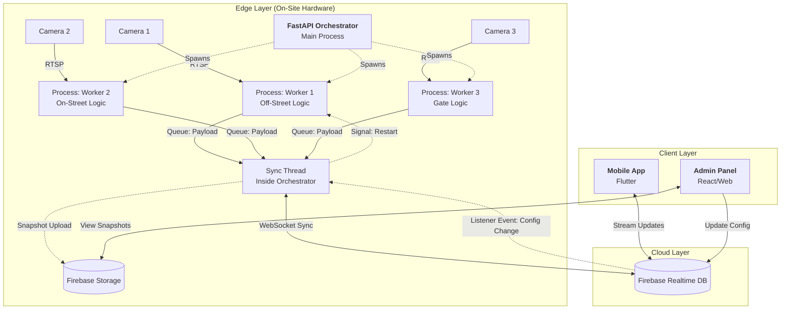

# Smart Parking System Architecture

## 1. System Overview

This project is an IoT-based Smart Parking solution that utilizes Computer Vision to detect real-time parking occupancy. The system follows an **Edge-Cloud-Client** pattern, processing video feeds locally on-site to minimize bandwidth, while synchronizing state to the cloud for instant user access.

**Key Capabilities:**

- **Real-time Detection:** Uses RT-DETR/YOLO models to detect vehicles.
- **Edge Orchestration:** A FastAPI server manages multiple camera feeds using multiprocessing.
- **Remote Configuration:** Admin can redraw parking spots remotely; the Edge node listens for changes and reloads workers automatically.

---

## 2. High-Level Architecture Diagram

---

## 3. Detailed Component Breakdown

### A. The Edge Layer (The "Eyes")

- **Hardware:** NVIDIA Jetson (Orin/Nano) or GPU-enabled Server.
- **Software:** Python, FastAPI, Ultralytics, Multiprocessing.

#### The Orchestrator (FastAPI):

The central manager that runs as the parent process.

- **Role:** Reads configuration from Firebase/Local Config to spawn camera workers.
- **Concurrency:** Uses `multiprocessing` to run AI models on separate CPU cores (bypassing GIL).
- **Sync Manager:** A dedicated background thread reads a unified `Queue` and pushes updates to Firebase, maintaining a single socket connection.
- **Health Checks:** Exposes `GET /health` and reports heartbeat to the cloud.

#### The Worker Processes (The Logic):

Modularized processes based on the "Type" defined in the schema:

- **Type 1 (Off-Street):** Uses **Point-in-Polygon**. Detects if a vehicle center is inside specific marked bays (e.g., "Slot C1").
- **Type 2 (On-Street):** Uses **Linear Estimation**. Draws a "Ruler" of small segments along a curb. Calculates availability based on how many segments are covered (e.g., "15 segments / 5 per car = 3 spots").
- **Type 3 (Gate):** Uses **Line Crossing** (Roboflow Supervision). Multiple gates can be used to count the number of vehicles in the parking lot by keeping track of the total in vehicles.

### B. The Cloud Layer (The "Brain")

- **Service:** Google Firebase Realtime Database.

#### Database Schema (`locations/{node_id}`):

The data is strictly separated into three buckets within the node:

1.  **`config` (Read-Only for Edge):**
    - Contains Camera RTSP URLs, Worker Types, and Polygon Coordinates.
    - Edited by the Admin Panel.
2.  **`live_status` (Write-Only for Edge):**
    - _Off-Street:_ Status of specific slots (`C1: "free"`).
    - _On-Street:_ Metrics (`estimated_free_cars: 2`).
    - _Gate:_ Counts (`current_inside: 45`).
3.  **`system_health`:**
    - Heartbeat data (`last_seen`, `status: "online"`).

#### Storage:

Stores periodic snapshots (images) from cameras for the Admin Panel to verify detection accuracy and calibrate polygons.

### C. The Client Layer (The Interface)

#### 1. User Mobile App (Flutter)

- **Feature:** Live Map with colored markers.
- **Logic:** Listens to `live_status` path.
  - For Off-Street: Draws Green/Red boxes based on slot IDs.
  - For On-Street: Displays a number ("~3 spots available").

#### 2. Admin Panel (Web)

- **Feature:** Analytics Dashboard & Remote Calibration.
- **Remote Config Workflow:**
  1.  Admin selects a camera and requests a snapshot.
  2.  Admin draws new polygons over the image on the web interface.
  3.  Admin saves changes to `config/.../polygons` in Firebase.
  4.  Edge Orchestrator detects the change via Listener, kills the specific Worker, and respawns it with new coordinates.

---

## 4. Data Flow Scenarios

### Scenario A: A Car Parks (Off-Street)

1.  **Capture:** Worker Process captures a frame from RTSP.
2.  **Inference:** RT-DETR detects a vehicle.
3.  **Logic:** Point-in-Polygon determines the vehicle is inside "Slot C5".
4.  **IPC:** Worker pushes payload `{"id": "cam_1", "data": {"C5": "occupied"}}` to the internal Multiprocessing Queue.
5.  **Sync:** Orchestrator's Sync Thread picks up the item from the Queue.
6.  **Upload:** Sync Thread updates `locations/Node_A/live_status/cam_1/slots/C5` in Firebase.
7.  **Client:** Mobile App receives the update via WebSocket and turns the marker Red.

### Scenario B: Admin Updates Parking Layout

1.  Admin redraws a parking spot on the Web Dashboard.
2.  Admin Panel updates `locations/Node_A/config/cam_1/polygons` in Firebase.
3.  **Listener:** Orchestrator's background thread (listening to `config`) triggers a callback.
4.  **Restart:** Orchestrator identifies `cam_1` was updated. It sends a `SIGTERM` to Worker 1.
5.  **Respawn:** Orchestrator spawns a new Worker 1 process, injecting the new Polygon coordinates from the config.
